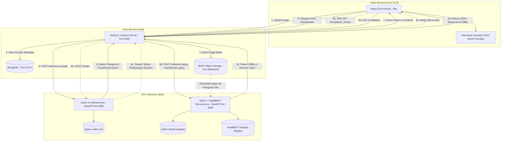

# GeoScout: Multi-Modal Geospatial Intelligence Platform
## Comprehensive Technical Architecture & Project Analysis

> **Target Audience:** Technical project defense / Academic viva with GeoScout / University professors.  
> **Repository:** GeoScout codebase.  
> **Author / Analyst:** Antigravity AI Pair Programmer.  
> **Environment Note:** Analysis performed in read-only mode on the actual codebase.

---

## Table of Contents
1. [Project Overview](#1-project-overview)
2. [Folder-by-Folder Codebase Tour](#2-folder-by-folder-codebase-tour)
3. [How the Components are Connected (End-to-End Request Flow)](#3-how-the-components-are-connected)
4. [The AI & Computer Vision Pipeline in Code](#4-the-ai--computer-vision-pipeline-in-code)
5. [Deployment Architecture & Docker Deep-Dive](#5-deployment-architecture--docker-deep-dive)
6. [How to Start & Hardware Feasibility (Windows + RTX 4050 6 GB)](#6-how-to-start--hardware-feasibility)
7. [Limitations, Code Bugs, and Security Concerns](#7-limitations-code-bugs-and-security-concerns)
8. [Comprehensive Viva Examination Preparation (15 Questions & Answers)](#8-comprehensive-viva-examination-preparation)

---

## 1. Project Overview

### What the Project Does in Simple Words
**GeoScout** is an end-to-end Geospatial Natural Language Interface designed for satellite and aerial remote sensing imagery, built for the GeoScout Tech Meet / GeoScout competition. 

In traditional remote sensing systems, analysts must use complex GIS software (e.g., QGIS, ArcGIS) or write custom computer vision scripts to detect runways, count storage tanks, calculate playground areas, or track ships. **GeoScout solves this by enabling zero-shot, interactive conversational AI over satellite imagery.** An analyst simply drags and drops a satellite image and types free-form questions in plain English—such as *"Describe this scene"*, *"Is there a swimming pool?"*, *"Count the airplanes"*, *"Locate the storage tanks with oriented bounding boxes"*, or *"What is the area of the green ground track field?"*

The system dynamically classifies user intent, routes queries to specialized AI backbones (a 4-bit Vision-Language Model and a Segment Anything / Computer Vision pipeline), and displays answers with interactive reasoning logs, vector bounding box overlays, pan/zoom tools, and session sharing.

---

### Complete List of Features Across Frontend, Backend, and Inference

| Feature Area | Specific Capability | Implementation Mechanism |
| :--- | :--- | :--- |
| **Holistic Captioning** | 50-word scene context & holistic description (e.g., terrain, urban density, vegetation distribution). | `QwenModel` with task `captioning`, strictly 10–200 words. |
| **Binary VQA** | Strict Yes/No verification (e.g., *"Is there a helicopter visible?"*). | `QwenModel` with task `vqa_binary`, strictly 1 word. |
| **Semantic Attribute VQA** | Open-ended queries about attributes (color, roof type, aircraft category). | `QwenModel` with task `vqa_semantic`, strictly 1–5 words. |
| **Visual Grounding / Localization** | Oriented Bounding Box (OBB) detection for arbitrary aerial objects (airplanes, swimming pools, storage tanks). | `SAM3Model` instance & semantic segmentation + OpenCV `minAreaRect` + Shapely IoB1 semantic filtering. |
| **Numeric VQA: Counting** | Counting occurrences of specific aerial targets. | Intent routed via DistilBERT `classify.py` to `count` $\rightarrow$ count of filtered SAM 3 OBBs. |
| **Numeric VQA: Area Estimation** | Calculating metric surface area ($m^2$) or percentage surface area. | DistilBERT routes to `area` $\rightarrow$ SAM 3 mask $\rightarrow$ `cv2.contourArea` $\times \text{resolution}^2$. |
| **Numeric VQA: Length / Perimeter** | Measuring perimeter or linear boundary of objects. | DistilBERT routes to `length` $\rightarrow$ SAM 3 mask $\rightarrow$ `cv2.arcLength` (see bug note in Section 7). |
| **Chain-of-Thought (CoT) Streaming** | Real-time SSE streaming with collapsible internal monologue. | Qwen streaming via `TextIteratorStreamer`, formatted with mandatory gerund headings (`* Analyzing: ...`). |
| **Smart Query Transformation** | Stripping query verbs to isolate target nouns for segmentation. | Qwen zero-shot prompt transforms *"Locate swimming pools"* $\rightarrow$ *"swimming pools"*. |
| **Interactive Image Canvas** | Vector OBB rendering, zoom (up to 5x), pan, drag-and-drop. | React SVG overlay `<polygon>` and `<rect>` elements with canvas export. |
| **Burned-In Image Export** | Downloading satellite image with vector OBBs permanently drawn. | HTML5 Canvas drawing + `toBlob` download in `ChatWindow.jsx`. |
| **Automatic Chat Titling** | Generating descriptive chat sidebar titles based on image context. | VLM call with task `sidebar_title` (< 5 words) upon image upload. |
| **Collaboration & Sharing** | Public share links with granular `view` or `edit` permissions. | Crypto random tokens stored in MongoDB with public token lookup route. |
| **Role-Based Auth & Whitelist** | Secure signup restricted to admin-whitelisted email addresses. | JWT cookies + Bcrypt + MongoDB whitelist flag + Admin Dashboard. |
| **Competition Evaluation API** | Standardized endpoint `/api/evaluate` matching GeoScout benchmark schema. | Multi-query automated evaluation orchestrator in `evaluation.js`. |

---

## 2. Folder-by-Folder Codebase Tour

```
geoscout/
├── backend/            # Node.js/Express orchestration API server
├── deployment/         # Docker Compose files, entrypoints & shell deployment scripts
├── frontend/           # React 19 + Vite + TailwindCSS 4 web client
├── inference/          # Python AI microservices (Qwen VLM and SAM 3 + DistilBERT)
└── services/           # Auxiliary standalone setup script for MinIO and MongoDB
```

---

### 1. `backend/`
- **Language / Framework:** Node.js (v20+ ES Modules), Express.js (v5.1), Mongoose ODM, MinIO SDK.
- **Purpose:** Acts as the central business logic controller, authenticates users, manages sessions, persists images to MinIO S3 object storage, saves chat histories to MongoDB, and dispatches inference requests to Python microservices.
- **Key Files:**
  - `server.js`: Server entrypoint; initializes database connection via `connectDB()` and binds Express to `PORT` (5000).
  - `app.js`: Configures CORS, JSON parsing, cookie-parser, mounts API routers (`/api/admin`, `/api/user`, `/api/chat`, `/api/evaluate`), and provides a direct `/api/classify` proxy.
  - `controllers/chat.js`: The heart of the backend (483 lines). Implements `createChat`, `getChatById`, `populateChatDescription`, `generateCompletion`, `chatStream` (Server-Sent Events), `renameChat`, `deleteChat`, `shareChat`, `revokeShare`, `getSharedChat`, and `updateChatTimes`.
  - `controllers/evaluation.js`: Implements the official benchmark evaluation handler `getResponse`, which executes captioning, grounding, binary VQA, numeric VQA, and semantic VQA in sequence on an input image.
  - `controllers/auth.js`: Implements `signup` (whitelist validation), `login` (Bcrypt comparison), `logout` (cookie invalidation), and `getMe`.
  - `controllers/admin.js`: Administrative user management (`createUser`, `getUsers`, `updateRole`, `deleteUser`, `updateWhitelist`).
  - `routes/chat.js`: Declares Express routes for chat sessions, file upload middleware (`multer`), completions, streaming, and sharing.
  - `routes/admin.js`, `routes/user.js`, `routes/evaluation.js`: Declare administrative, auth, and benchmark evaluation endpoints.
  - `models/chat.js`: Mongoose schema for `Chat`, storing user reference, `image_key`, description, array of sub-documents `chats` (query, reasoning, response, `bounding_boxes` 8-point coordinates, timing metrics), and share tokens.
  - `models/user.js`: Mongoose schema for `User` storing email, hashed password, role (`1: user`, `2: admin`), and `isWhitelisted`.
  - `middlewares/auth.js`: JWT cookie verification (`isAuthenticated` blocks unauthenticated requests; `forwardAuthenticatedUser` attaches user if present but allows guest access).
  - `middlewares/error.js`: Centralized Express error handler class and middleware.
  - `config/database.js`: Connects to MongoDB via Mongoose using credentials from constants.
  - `config/minio.js`: Instantiates `minioClient` pointing to MinIO server.
  - `config/constants.js`: Resolves dev vs production MongoDB URIs and database names.
  - `utils/minio.js`: `saveImageAndGetObjectKey` (uploads image buffer to `uploads/<uuid>.<ext>`) and `getPresignedUrl` (generates 1-hour presigned GET URL).
  - `utils/inference.js`: Axios HTTP client wrapper communicating with Python inference servers (`inference()` and fallback `mockInference()`).
  - `utils/utils.js`: Higher-order helper functions (`tryCatch`, `normalizeBBoxes`, and controller injection wrappers).
  - `Dockerfile`: Node.js 20-alpine container definition.

---

### 2. `deployment/`
- **Language / Framework:** POSIX Bash, Docker Compose (v3.8), MongoDB Initialization Scripts.
- **Purpose:** Automates full-stack provisioning, network bridge creation, model weight fetching via Google Drive, and multi-container lifecycle management.
- **Key Files:**
  - `deploy-all.sh`: Automated single-click deployment wizard for single-machine deployment. Automatically detects local host IP, prompts for credentials, downloads weights via `gdown`, and builds/starts all 7 containers.
  - `deployment.sh`: Interactive deployment wizard offering a 3-way menu: (1) Single Machine, (2) Core Only (for distributed inference), (3) Reset/Stop.
  - `start-inference-node.sh`: Script dedicated to running on a remote high-VRAM GPU server. Downloads SAM3, DistilBERT, Transformers, and Qwen weights, builds GPU images, and runs them via `docker run --gpus all`.
  - `docker-compose.yml`: Full single-machine multi-container manifest containing 7 services (`mongodb`, `minio`, `minio-init`, `backend`, `frontend`, `inference-qwen`, `inference-sam`).
  - `docker-compose.core.yml`: Lightweight manifest for the web server in distributed mode (runs `mongodb`, `minio`, `minio-init`, `backend`, `frontend`; points to remote GPU host).
  - `mongo-init.js`: MongoDB replica/database initialization script that pre-seeds the initial administrator (`admin@geoscout.org`, empty password, role 2, whitelisted).
  - `mongo-entrypoint.sh`: Container entrypoint that starts `mongod` in the background, executes `mongo-init.js` via `mongosh`, and tails logs.
  - `see-logs.sh`: Quick troubleshooting script to tail backend container logs.
  - `.env.example`: Template for environment variables (`HOST_IP`, `MONGO_ROOT_USER`, `JWT_SECRET`, `MINIO_BUCKET`, etc.).

---

### 3. `frontend/`
- **Language / Framework:** JavaScript (ES6+), React 19 (`^19.2.0`), Vite 7, TailwindCSS 4 (`^4.1.17`), React Router DOM 7.
- **Purpose:** Delivers a modern single-page web interface with real-time SSE streaming, interactive SVG bounding box manipulation, pan/zoom canvas controls, admin dashboard, and share modal.
- **Key Files:**
  - `src/App.jsx`: Root router configuration setting up routes (`/`, `/chat`, `/chat/:chatId`, `/shared/:token`, `/admin/dashboard`) wrapped in `AuthProvider`.
  - `src/pages/MainChat.jsx`: Main interface orchestrating chat state, image uploading, query classification call, streaming SSE listeners, non-streaming completion calls, and sidebar management (619 lines).
  - `src/components/ChatWindow.jsx`: Complex split-pane UI (998 lines). The left pane renders the remote sensing image with pan/zoom controls and an SVG vector overlay for 8-point polygons; the right pane renders collapsible thinking logs and markdown solutions.
  - `src/components/ImageUpload.jsx`: Drag-and-drop or browse satellite image uploader.
  - `src/components/ShareModal.jsx`: Modal allowing owners to generate shareable links with `view` or `edit` permissions or revoke existing access.
  - `src/components/chat/Sidebar.jsx`: Collapsible navigation drawer displaying past chat history, new chat trigger, search bar, and user profile menu.
  - `src/pages/AdminDashboard.jsx`: Table-driven user management dashboard for system administrators to view users, grant admin privileges, and whitelist new accounts.
  - `src/pages/SharedChat.jsx`: View-only or collaborative chat page for external users accessing via a share token.
  - `src/pages/Auth.jsx`: Login and signup view with animated particle background.
  - `src/services/api.js`: Axios instance and full catalog of frontend API calls (chat, user, admin, streaming EventSource).
  - `src/context/AuthContext.jsx`: React context managing current user session state, login, and logout.
  - `Dockerfile`: Node.js 20-alpine container running Vite dev server exposed on port 5173.

---

### 4. `inference/`
- **Language / Framework:** Python 3.10, PyTorch, FastAPI, Uvicorn, Unsloth, Hugging Face Transformers, OpenCV (`cv2`), Shapely.
- **Purpose:** High-performance GPU microservices hosting the computer vision and vision-language models.

#### Subfolder: `inference/qwen/`
- `app.py`: FastAPI application running on port 3000. Provides `/stream` (SSE streaming inference using `StreamingResponse` and background image cleanup) and `/inference` (synchronous execution for classification and benchmark evaluation).
- `qwen_model.py`: Model wrapper around `FastVisionModel` (Unsloth). Quantizes the model in 4-bit (`load_in_4bit=True`), formats prompts with task constraints (captioning, binary VQA, semantic VQA, sidebar titling, intent classification), and yields streaming tokens via `TextIteratorStreamer`.
- `utils.py`: Asynchronous helper `get_image_path(image_url)` that downloads images from MinIO presigned URLs via `httpx` to local temporary disk files.
- `Dockerfile`: NVIDIA PyTorch CUDA 12.6 devel image with Unsloth, Transformers, and BitsAndBytes.

#### Subfolder: `inference/sam3/`
- `app.py`: FastAPI application running on port 8000. Exposes `/inference` to handle `vqa_numeric` and `grounding` requests.
- `sam3_model.py`: Orchestrates SAM 3 instance and semantic segmentation. Converts binary masks into oriented bounding boxes (`mask_to_obb_all_coords`), applies rotated NMS (`nms_8point_opencv`), filters instance boxes against semantic masks using Shapely polygon IoB1, and delegates numeric queries to DistilBERT.
- `classify.py`: Fine-tuned DistilBERT sequence classification wrapper that classifies numeric queries into `area`, `length`, or `count`.
- `utils.py`: Computer vision math routines: `calculate_area` (OpenCV `cv2.contourArea`), `calculate_perimeter` (`cv2.arcLength`), `mask_to_rotated_box`, `overlay_masks`, and `plot_rotated_boxes_from_path`.
- `Dockerfile`: Python 3.10-slim container with OpenCV dependencies (`libgl1`, `libglib2.0-0`), PyTorch CU121, Shapely, and local Transformers library.

---

### 5. `services/`
- **Purpose:** Provides a lightweight alternative for running only the auxiliary data storage containers on a bare-metal Linux host without docker-compose.
- **Key Files:**
  - `start-services.sh`: Starts MinIO (ports 9000/9001) and MongoDB (port 27017) using raw `docker run` commands and executes a mongosh script to seed the default admin account.
  - `.env.example`: Environment variables for MinIO and MongoDB credentials.

---

## 3. How the Components are Connected

### Complete Request Walkthrough
Let us trace an end-to-end user journey: A user uploads a satellite image of an airfield and submits the query:  
> *"Locate all airplanes and return oriented bounding boxes."*

```
Step 1: Image Upload
[Browser / Frontend] 
   │  User drops 'airfield.png' into ImageUpload.jsx
   │  HTTP POST /api/chat (multipart/form-data)
   ▼
[Backend Server :5000] (routes/chat.js -> controllers/chat.js : createChat)
   │  Multer intercepts image in memory buffer
   │  saveImageAndGetObjectKey() uploads buffer to MinIO bucket 'chat-images'
   ▼
[MinIO Storage :9000]
   │  Stores object at 'uploads/<uuid>.png'
   │  Returns object key back to backend
   ▼
[MongoDB :27017]
   │  Chat.create({ user: userId, image_key: 'uploads/<uuid>.png', chats: [] })
   │  Returns new chat document (_id: 65a8...f1)
   ▼
[Frontend]
   │  Receives { chat_id: "65a8...f1" }, redirects to /chat/65a8...f1
   │  Calls GET /api/chat/describe/65a8...f1 to auto-generate title via Qwen

──────────────────────────────────────────────────────────────────────────────────────────

Step 2: Query Classification & Transformation
[Frontend]
   │  User types: "Locate all airplanes and return oriented bounding boxes"
   │  MainChat.jsx calls api.post('/classify', { query, image_url })
   ▼
[Backend Server :5000] (app.js : app.post('/api/classify'))
   │  Proxies request to Qwen service: POST http://inference-qwen:3000/inference
   │  Payload: { image_url, query, category: "classify" }
   ▼
[Qwen Service :3000] (qwen_model.py : infer(task='classify'))
   │  Evaluates zero-shot prompt with Step 1 (Classify) and Step 2 (Transform)
   │  Classifies intent as: 'grounding'
   │  Transforms query (strips command verb 'Locate', 'return OBB'): 'airplanes'
   │  Returns string: "grounding ||| airplanes"
   ▼
[Frontend]
   │  Receives { category: "grounding", transformed_query: "airplanes" }
   │  Checks: to_stream = (category !== "vqa_numeric" && category !== "grounding")
   │  to_stream is FALSE -> Uses synchronous completion endpoint

──────────────────────────────────────────────────────────────────────────────────────────

Step 3: Grounding Inference via SAM 3 & OpenCV
[Frontend]
   │  Calls GET /api/chat/completion?chat_id=...&category=grounding&transformed_query=airplanes
   ▼
[Backend Server :5000] (controllers/chat.js : generateCompletion)
   │  Identifies category is 'grounding' -> routes to INFERENCE_URL_SAM (port 8000)
   │  Generates 1-hour presigned MinIO URL for the image
   │  Calls POST http://inference-sam:8000/inference
   ▼
[SAM 3 Service :8000] (sam3_model.py : infer() -> get_final_boxes())
   │  1. Downloads image from presigned URL via httpx to temp file
   │  2. Sam3Processor encodes image & text prompt ("airplanes")
   │  3. Sam3Model executes forward pass -> outputs instance masks & semantic mask
   │  4. For each instance mask -> cv2.findContours -> cv2.minAreaRect -> cv2.boxPoints
   │     Produces initial 8-point OBBs
   │  5. cv2.dnn.NMSBoxesRotated removes duplicate/overlapping boxes (score_thresh=0.0, nms=0.5)
   │  6. Semantic mask converted to contours -> semantic OBBs
   │  7. Shapely polygon calculate_iob1 checks overlap between instance OBB & semantic OBB
   │     Only keeps instance boxes where IoB1 > 0.5 against semantic mask
   │  8. Coordinates normalized by [w, h] to range [0, 1]
   │  9. Temp image deleted from disk
   │  Returns { response: "", bounding_boxes: [[x1, y1, x2, y2, x3, y3, x4, y4], ...] }
   ▼
[Backend Server :5000]
   │  Normalizes bounding box coordinates
   │  Pushes { query, response: "Requested bounding boxes have been generated", bounding_boxes }
   │  Saves to MongoDB Chat document
   │  Returns JSON to frontend
   ▼
[Frontend] (ChatWindow.jsx)
   │  Receives bounding box arrays
   │  scaledBoxes calculates display coordinates relative to natural image dimensions
   │  Renders vector SVG <polygon points="x1,y1 x2,y2 x3,y3 x4,y4" /> over image
   │  Renders assistant message in chat bubble with latency badge
```

---

### Mermaid Architecture & Communication Diagram



---

## 4. The AI Pipeline in Code

### 1. Qwen-VL Vision-Language Model
- **File:** `inference/qwen/qwen_model.py`
- **Loading:** Loaded via `unsloth.FastVisionModel`:
  ```python
  self.model, self.tokenizer = FastVisionModel.from_pretrained(
      model_name="qwen_lora_model",
      max_seq_length=16384,
      load_in_4bit=True,
  )
  ```
  The model weights are loaded with **BitsAndBytes 4-bit quantization** (`load_in_4bit=True`), fitting the LoRA weights into constrained VRAM.
- **Inference Execution:**
  The `infer()` method supports two primary modes:
  1. **Intent Classification & Query Transformation (`task == 'classify'`):**
     Executes with low temperature (`0.2`). Uses a structured few-shot system prompt instructing the model to assign queries into:
     - `captioning`: Holistic scene description.
     - `vqa_binary`: Strict YES/NO answers.
     - `vqa_semantic`: Open-ended scene attributes.
     - `vqa_numeric`: Object counting or spatial dimensions.
     - `grounding`: Requests with verbs like *Locate*, *Find*, *Detect*, *Segment*, or *OBB*.
     In Step 2 (Transform), it strips command words and extracts solely the target noun phrase (e.g., *"Locate swimming pools"* $\rightarrow$ *"swimming pools"*). The output is formatted with delimiter: `Category ||| Transformed Query`.
  2. **Streaming Chain-of-Thought (CoT) Generation (`to_stream=True`):**
     Executes with `temperature=1.0` and `min_p=0.1`. The prompt strictly enforces:
     - Output must start immediately with `<REASONING>`.
     - Every reasoning bullet must start with a **Gerund Phrase** (`* Verb+ing: description`).
     - Closes with `</REASONING>` followed by `<SOLUTION>...</SOLUTION>`.
     - Generation executes in a background Python `threading.Thread` targeting `self.model.generate`, feeding tokens through `transformers.TextIteratorStreamer`.

---

### 2. SAM 3 (Segment Anything Model 3) Pipeline
- **File:** `inference/sam3/sam3_model.py`
- **Loading:**
  ```python
  self.sam_model = Sam3Model.from_pretrained("sam_model")
  self.sam_processor = Sam3Processor.from_pretrained("sam_model")
  self.sam_model.to(device).eval()
  ```
- **Execution & Post-Processing (`get_output`):**
  Images and text prompts (e.g., *"airplanes"*) are encoded via `Sam3Processor`. Model outputs are post-processed through:
  ```python
  results = self.sam_processor.post_process_instance_segmentation(
      outputs, threshold=0.1, mask_threshold=0.5, target_sizes=...
  )[0]
  output_seg = self.sam_processor.post_process_semantic_segmentation(
      outputs, threshold=0.5, target_sizes=...
  )[0]
  ```
- **Mask to Oriented Bounding Box (OBB):**
  In `mask_to_obb_all_coords(mask)`:
  1. Converts binary mask to 8-bit image: `(mask > 0).astype(np.uint8) * 255`.
  2. Finds external contours: `cv2.findContours(mask, cv2.RETR_EXTERNAL, cv2.CHAIN_APPROX_SIMPLE)`.
  3. Takes the largest contour: `cnt = max(contours, key=cv2.contourArea)`.
  4. Calculates minimum area rotated bounding box: `rect = cv2.minAreaRect(cnt)` (returns center $(x, y)$, dimensions $(w, h)$, and rotation angle $\theta$).
  5. Computes the 4 corner vertices: `box = cv2.boxPoints(rect)`.
  6. Flattens into 8 coordinates: `[x1, y1, x2, y2, x3, y3, x4, y4]`.
- **Rotated Non-Maximum Suppression (NMS):**
  In `nms_8point_opencv()`:
  Converts 8-point coordinates back into `cv2.minAreaRect` objects and calls OpenCV's dedicated rotated box NMS:
  ```python
  keep_indices = cv2.dnn.NMSBoxesRotated(
      bboxes=rotated_rects,
      scores=scores,
      score_threshold=0.0,
      nms_threshold=0.5
  )
  ```
- **Semantic Mask Verification (IoB1 Filtering):**
  To prevent false positives from instance segmentation, `sam3_model.py` converts the semantic segmentation mask into semantic bounding boxes (`semantic_mask_to_obb`). For each candidate instance box, it computes the **Intersection over Box 1 (IoB1)** against all semantic boxes using Shapely polygons:
  $$\text{IoB1} = \frac{\text{Area}(\text{Instance} \cap \text{Semantic})}{\text{Area}(\text{Instance})}$$
  Only boxes with $\text{IoB1} > 0.5$ are retained.
- **Coordinate Normalization:**
  Corner coordinates are normalized by image dimensions:
  `box_arr[0::2] /= width`, `box_arr[1::2] /= height`, clipped to $[0.0, 1.0]$.

---

### 3. DistilBERT Numeric Query Router & OpenCV Measurement
- **Files:** `inference/sam3/classify.py`, `inference/sam3/utils.py`, `inference/sam3/sam3_model.py`
- **DistilBERT Sequence Classification:**
  When a query is classified as `vqa_numeric`, it is passed to a fine-tuned DistilBERT model (`AutoModelForSequenceClassification.from_pretrained("bert_model_subtype")`).
  The output logits are mapped using dictionary:
  ```python
  idx2label = {0: 'count', 1: 'area', 2: 'length'}
  ```
- **Contour Measurement Logic:**
  - **Count (`sub_class == 'count'`):**
    Executes `get_final_boxes()` and returns integer count `len(boxes)`.
  - **Area Calculation (`sub_class == 'area'`):**
    Executes `calculate_area(mask, resolution)` in `utils.py`:
    ```python
    contours, _ = cv2.findContours(mask.astype(np.uint8), cv2.RETR_EXTERNAL, cv2.CHAIN_APPROX_SIMPLE)
    largest_contour = max(contours, key=cv2.contourArea)
    pixel_count = cv2.contourArea(largest_contour)
    if resolution is not None:
        area = pixel_count * (resolution ** 2)  # In square meters
    else:
        area = (pixel_count / (mask.shape[0] * mask.shape[1])) * 100  # Percentage
    ```
  - **Perimeter / Length (`sub_class == 'length'`):**
    Implements `calculate_perimeter(mask, resolution)` in `utils.py`:
    ```python
    perimeter = cv2.arcLength(largest_contour, closed=True)
    if resolution:
        perimeter *= resolution
    ```

---

### 4. Model Weights & Origins

| Model | Path in Codebase | Download Source | Download Tool |
| :--- | :--- | :--- | :--- |
| **SAM 3 Weights** | `inference/sam3/sam_model/` | Google Drive folder `1P2e9nHGA8Sl27cbW6TAHD3-ZrcfIYRrS` | `gdown --folder` |
| **DistilBERT Subtype** | `inference/sam3/bert_model_subtype/` | Google Drive folder `1rbTuVncSDDb4LwKhF65RYJoBwUPBVdqo` | `gdown --folder` |
| **Qwen LoRA Weights** | `inference/qwen/qwen_lora_model/` | Google Drive folder `1ez_3K-0Q3-6DIePvdH8x_lH1fjHGqFm1` | `gdown --folder` |
| **Hugging Face Transformers Fork** | `inference/sam3/transformers/` | Git repository: `https://github.com/huggingface/transformers` | `git clone --depth 1` |

---

## 5. Deployment Architecture & Docker Deep-Dive

### Line-by-Line Breakdown of Deployment Scripts

#### `deployment/deploy-all.sh`
```bash
1-8:   Header printing. Sets ENV_FILE=".env".
9-18:  IP Detection: Uses 'ip route get 1.1.1.1' or 'hostname -I' to determine machine IP. Fallback: 127.0.0.1.
20-30: Prompts user for Host IP, MongoDB/MinIO username (default: admin_geoscout), password (default: secure_password), and MinIO bucket (chat-images).
32:    Generates a cryptographically random 32-byte hexadecimal JWT secret via 'openssl rand -hex 32'.
34-45: Writes the gathered environment variables to deployment/.env.
48:    If .env already exists, skips prompts and sources .env directly.
51-53: Writes VITE_API_BASE_URL=http://$HOST_IP:5000/api into frontend/.env so Vite can bake it at build time.
56:    Installs Python 'gdown' utility quietly via pip.
58-68: Declares 'ensure_dir()' function to check if a model directory exists and is non-empty.
70-71: Checks and downloads SAM3 model weights from Google Drive folder ID 1P2e9nHGA8Sl27cbW6TAHD3-ZrcfIYRrS.
73-74: Checks and downloads DistilBERT model weights from Google Drive folder ID 1rbTuVncSDDb4LwKhF65RYJoBwUPBVdqo.
76-77: Checks and clones Hugging Face transformers repo (depth 1) into inference/sam3/transformers.
79-80: Checks and downloads Qwen LoRA weights from Google Drive folder ID 1ez_3K-0Q3-6DIePvdH8x_lH1fjHGqFm1.
84-86: Exports HOST_IP and VITE_API_BASE_URL, then runs 'docker compose -f docker-compose.yml up -d --build'.
88-95: Displays access URLs (Frontend on 5173, Backend on 5000, MinIO Console on 9001).
```

#### `deployment/deployment.sh`
- Lines 1–58: Gathers environment variables identical to `deploy-all.sh`.
- Lines 59–71: Configures `frontend/.env`.
- Lines 73–80: Interactive prompt presenting three deployment options:
  - **Option 1 (Single Machine):** Runs `docker compose -f docker-compose.yml up -d --build`.
  - **Option 2 (Core Only):** Prompts for remote GPU machine IP, Qwen port (3000), and SAM port (8000), appends them to `.env`, and launches `docker-compose.core.yml`.
  - **Option 3 (Reset):** Runs `docker compose down` on both manifests and forcibly removes lingering inference containers (`geoscout_qwen`, `geoscout_sam`).

#### `deployment/start-inference-node.sh`
- Lines 1–32: Installs `gdown`, downloads SAM 3, DistilBERT, Transformers, and Qwen weights onto the remote GPU server, and resolves absolute paths.
- Lines 35–56: Defines `run_if_not_exists()` helper that builds a Docker image and runs a standalone container with `--gpus all`, host port mapping, and host model volume mounting.
- Lines 60–65: Builds and runs `geoscout_inference_qwen` on port 3000 and `geoscout_inference_sam` on port 8000.

---

### Containers, Ports, Inter-Container Communication & GPU Access

| Container Name | Base Image | Internal Port | Exposed Host Port | Purpose | GPU Required? |
| :--- | :--- | :--- | :--- | :--- | :--- |
| `geoscout_mongodb` | `mongo:latest` | 27017 | 27017 | Document store for users and chats | No |
| `geoscout_minio` | `minio/minio` | 9000, 9001 | 9000, 9001 | S3-compatible image object storage | No |
| `geoscout_minio_init` | `minio/mc` | N/A | None | Initialization job: creates bucket and sets public download policy | No |
| `geoscout_backend` | `node:20-alpine` | 5000 | 5000 | Express API & orchestrator | No |
| `geoscout_frontend` | `node:20-alpine` | 5173 | 5173 | Vite React UI server | No |
| `geoscout_inference_qwen` | `pytorch/...-devel` | 3000 | 3000 | Qwen VLM FastAPI microservice | **Yes (NVIDIA GPU)** |
| `geoscout_inference_sam` | `python:3.10-slim` | 8000 | 8000 | SAM 3 + DistilBERT FastAPI microservice | **Yes (NVIDIA GPU)** |

#### Network & GPU Reservation Details:
- **Internal Communication:** All containers reside on Docker's default bridge network. The backend talks to database and inference containers using internal DNS names:
  - `mongodb://...:27017`
  - `http://inference-qwen:3000`
  - `http://inference-sam:8000`
- **Browser-to-Storage Communication:** `MINIO_ENDPOINT` is passed as the host machine's public/LAN IP (`${HOST_IP}`) rather than `minio`. This is intentional: presigned image URLs generated by MinIO must be resolvable by the end user's web browser.
- **GPU Passthrough:** In `docker-compose.yml`, GPU access is declared under the `deploy` stanza:
  ```yaml
  deploy:
    resources:
      reservations:
        devices:
          - driver: nvidia
            count: 1
            capabilities: [gpu]
  ```
  In `start-inference-node.sh`, raw Docker uses `--gpus all`.

---

### Single-Machine vs. Distributed Deployment

```
[Option 1: Single-Machine Setup]
┌────────────────────────────────────────────────────────────────────────┐
│ HOST MACHINE (Must have >= 16 GB VRAM GPU)                            │
│ ┌──────────────┐  ┌─────────────┐  ┌──────────────┐  ┌──────────────┐ │
│ │  Frontend    │  │   Backend   │  │   MongoDB    │  │    MinIO     │ │
│ │  (Port 5173) │  │ (Port 5000) │  │ (Port 27017) │  │ (Port 9000)  │ │
│ └──────────────┘  └─────────────┘  └──────────────┘  └──────────────┘ │
│ ┌───────────────────────────────┐  ┌────────────────────────────────┐ │
│ │ Qwen VLM Container (Port 3000)│  │ SAM 3 Container (Port 8000)    │ │
│ └───────────────────────────────┘  └────────────────────────────────┘ │
└────────────────────────────────────────────────────────────────────────┘

[Option 2: Distributed Setup]
┌───────────────────────────────────┐       ┌───────────────────────────────────┐
│ WEB SERVER (Low spec, No GPU req) │       │ GPU NODE (High VRAM Server)       │
│ - Frontend (:5173)                │  LAN  │ - Qwen Service (:3000)            │
│ - Backend (:5000)                 │◄─────►│ - SAM 3 Service (:8000)           │
│ - MongoDB (:27017)                │  WAN  │ (Runs start-inference-node.sh     │
│ - MinIO (:9000)                   │       │  with NVIDIA Container Toolkit)   │
│ (Runs docker-compose.core.yml)    │       └───────────────────────────────────┘
└───────────────────────────────────┘
```

- **Single Machine:** Controlled by `docker-compose.yml`. Ideal for a single cloud GPU instance (e.g. AWS `g4dn.xlarge` with T4 or `g5.xlarge` with A10G).
- **Distributed Mode:**
  - Web Server runs `docker-compose.core.yml`. Environment variables `INFERENCE_URL_SAM` and `INFERENCE_URL_QWEN` point to `${GPU_MACHINE_IP}:${SAM_PORT}` and `${GPU_MACHINE_IP}:${QWEN_PORT}`.
  - Inference Node runs `start-inference-node.sh`, exposing ports 3000 and 8000 directly.

---

## 6. How to Start & Hardware Feasibility

### Hardware Feasibility Analysis for Your Laptop
- **Your Hardware:** Windows Laptop with NVIDIA GeForce RTX 4050 Mobile (6 GB VRAM).
- **Hard Truth:**
  - `README.md` explicitly states: **"Minimum GPU required: T4 with 15 GB VRAM"**.
  - **Memory breakdown:**
    - Qwen Vision-Language model (Unsloth 4-bit): $\approx 4.5 \text{ to } 5.5\text{ GB VRAM}$.
    - SAM 3 model (PyTorch float16/float32): $\approx 6.0 \text{ to } 7.5\text{ GB VRAM}$.
    - DistilBERT subtype model: $\approx 0.5\text{ GB VRAM}$.
    - Combined concurrent requirement: **$\approx 11 \text{ to } 14\text{ GB VRAM}$**.
  - **Result on 6 GB RTX 4050:** Attempting to run Option 1 (Single Machine) will trigger an immediate **`torch.cuda.OutOfMemoryError: CUDA out of memory`** when the second model allocates tensors.
- **The Solution:** 
  Use **Option 2 (Distributed Setup)**! Run the Core services (Frontend, Backend, MongoDB, MinIO) locally on Windows/WSL2, and run the inference node on a cloud GPU (e.g., Google Colab with T4/A100, Kaggle, or a cloud VM).

---

### Step-by-Step Run Commands

#### Setup A: Distributed Mode (Recommended for RTX 4050 Laptop)

##### Part 1: On the Remote GPU Machine (Linux with T4 / A10G / A100 GPU)
1. Clone the repository and navigate to deployment:
   ```bash
   git clone <repo-url>
   cd deployment
   chmod +x *.sh
   ```
2. Launch the inference node (downloads model weights and starts Qwen + SAM containers):
   ```bash
   ./start-inference-node.sh
   ```
3. Verify containers are active:
   ```bash
   docker ps
   # Test endpoints:
   curl http://localhost:3000/health
   curl http://localhost:8000/health
   ```
   Note the public or LAN IP of this GPU machine (e.g., `192.168.1.100` or cloud IP).

##### Part 2: On Your Windows Machine (Core Web Services)
1. Open **WSL2 (Ubuntu)** or Git Bash:
   ```bash
   cd deployment
   chmod +x *.sh
   ```
2. Run the deployment wizard:
   ```bash
   ./deployment.sh
   ```
3. Enter your Windows machine's IP when prompted.
4. When prompted with the menu:
   ```text
   Select Deployment Mode:
   1) Single Machine
   2) Core Only (Backend/Frontend/DBs - Inference is on another machine)
   3) Reset
   ```
   **Choose Option 2.**
5. Enter the remote GPU machine's IP (e.g., `http://192.168.1.100`), Qwen port (`3000`), and SAM port (`8000`).
6. Access the web interface in your browser:
   - **Frontend UI:** `http://localhost:5173`
   - **Backend API:** `http://localhost:5000`
   - **MinIO Console:** `http://localhost:9001` (login with `admin_geoscout` / your password)
7. Log in with the pre-seeded admin email: `admin@geoscout.org` (navigate to `/signup` first to register password).

---

#### Setup B: Single-Machine Setup (On a Linux Server with $\ge 16\text{ GB}$ GPU)
1. Ensure NVIDIA Container Toolkit is installed (`nvidia-smi` working inside Docker).
2. Execute the single-click deploy script:
   ```bash
   cd deployment
   chmod +x deploy-all.sh
   ./deploy-all.sh
   ```
3. Monitor container logs:
   ```bash
   docker compose logs -f
   ```

---

### Prerequisites, Resource Requirements & Windows Gotchas

| Resource | Minimum Requirement | Recommended | Notes |
| :--- | :--- | :--- | :--- |
| **GPU VRAM** | 15 GB (Single Machine) | 24 GB (A10G / RTX 3090/4090) | Required to hold both Qwen 4-bit and SAM 3 in VRAM simultaneously. |
| **System RAM** | 16 GB | 32 GB | Docker container compilation and image processing. |
| **Disk Storage**| 40 GB free | 60 GB free | PyTorch Docker images ($\approx 15\text{ GB}$) + Weights ($\approx 15\text{ GB}$). |
| **Operating System**| Linux (Ubuntu 22.04+) or Windows with WSL2 | Ubuntu 22.04 LTS | Raw Windows PowerShell cannot run `.sh` deployment scripts without WSL2. |

#### Specific Windows Pitfalls:
1. **CRLF Line Endings:** Git on Windows often converts `LF` to `CRLF`. If bash scripts throw `\r: command not found`, run:
   ```bash
   dos2unix deployment/*.sh
   ```
2. **Docker Desktop WSL2 Backend:** Ensure Docker Desktop has "Use the WSL 2 based engine" enabled and NVIDIA GPU acceleration turned on under WSL settings.
3. **MinIO Presigned URL Host Resolution:** In `docker-compose.yml`, if `HOST_IP` is detected as `127.0.0.1`, external mobile devices or separate laptops cannot access presigned image URLs. Always use your actual LAN IPv4 (e.g. `192.168.x.x`).

---

## 7. Limitations, Code Bugs, and Security Concerns

During detailed source code inspection, several architectural bottlenecks, implementation bugs, and security risks were identified:

### 1. Functional Code Bug in Length / Perimeter Calculation
- **Location:** `inference/sam3/sam3_model.py`, lines 182–185:
  ```python
  elif(sub_class == 'length'):
      _ , mask = self.get_output(image , transformed_query)
      total_perimeter = calculate_area(mask.cpu().numpy(), resolution)
      return total_perimeter
  ```
- **Issue:** In line 184, the code calls `calculate_area` instead of `calculate_perimeter`!
- **Consequence:** When a user asks for length or perimeter (e.g., *"What is the perimeter of the runway?"*), the system calculates the surface area instead of arc length. The fix is simply changing `calculate_area` to `calculate_perimeter(mask.cpu().numpy(), resolution)`.

---

### 2. The "One-User-At-A-Time" Bottleneck
- **Location:** `inference/qwen/Dockerfile` line 29, `inference/sam3/Dockerfile` line 23:
  ```dockerfile
  CMD ["uvicorn", "app:app", "--host", "0.0.0.0", "--port", "3000", "--workers", "1"]
  ```
- **Issue:** Both FastAPI servers run with a single worker (`--workers 1`). In `app.py`, inference runs synchronously (`await loop.run_in_executor`).
- **Consequence:** Only a single user request can be processed at any moment. If User A submits a grounding query taking 15 seconds, User B's request hangs until User A completes. Concurrent requests risk socket timeouts.

---

### 3. Mock Inference Used in Shared Chat Messaging
- **Location:** `backend/routes/chat.js`, line 27:
  ```javascript
  router.post("/shared/:token/message", getAddMessageToSharedChatFunction(mockInference));
  ```
- **Issue:** The collaborative shared chat endpoint injects `mockInference` from `backend/utils/inference.js` rather than the real `inference` engine!
- **Consequence:** If an external collaborator types a message on a shared chat link, the backend generates a random simulated string from a hardcoded word pool after a dummy 5–10 second delay, rather than calling Qwen or SAM 3!

---

### 4. Security: Hardcoded Empty Admin Password & Default Credentials
- **Location:** `services/start-services.sh` lines 59–64, `deployment/mongo-init.js` lines 5–10:
  ```javascript
  db.users.insertOne({
      'email': 'admin@geoscout.org',
      'password': '',
      'role': 2,
      'isWhitelisted': true
  });
  ```
- **Issue:** The database pre-seeds an admin account with an empty password (`password: ''`). The `signup` controller checks:
  ```javascript
  if (user.password) return next(new ErrorHandler("User already exists", 409));
  ```
  Because the empty string `""` is falsy in JavaScript, anyone who discovers the deployment can visit `/signup`, enter `admin@geoscout.org`, set their own password, and immediately hijack root administrator access.
- **Fix:** Seed with a secure hashed bcrypt password or generate a one-time onboarding token.

---

### 5. Disk Accumulation & Temporary File Leak
- **Location:** `inference/sam3/utils.py` lines 17–30, `inference/sam3/app.py` lines 47–71:
  Images are saved to disk with UUID filenames (`f"{uuid.uuid4()}.jpg"`). While `app.py` calls `os.remove(image_path)` at the end of the route, if an exception is thrown during `model.infer` inside the thread executor, the code bypasses `os.remove`, causing orphaned JPEG files to accumulate inside the Docker container over time.
- **Fix:** Wrap inference in a `try...finally` block ensuring `os.remove(image_path)` is always invoked.

---

### 6. Permissive CORS Configuration
- **Location:** `inference/qwen/app.py` lines 34–40:
  ```python
  app.add_middleware(
      CORSMiddleware,
      allow_origins=["*"],
      allow_credentials=True,
      allow_methods=["*"],
      allow_headers=["*"],
  )
  ```
  Wildcard origins are permitted directly on the inference nodes. While protected behind a firewall in production, inside a shared network any client can bypass the backend and trigger GPU exhaustion.

---

## 8. Comprehensive Viva Examination Preparation

Here are 15 technical questions a professor or GeoScout evaluation panel is likely to ask, along with precise answers referencing the codebase.

---

### Q1: What is the core problem GeoScout solves, and why not use generic ChatGPT / GPT-4V?
**Answer:** Remote sensing imagery presents unique challenges: satellite images are nadir (top-down), contain tiny objects with arbitrary orientations (airplanes, ships), and require precise metric spatial calculations (area in $m^2$, boundary lengths). Standard VLMs like GPT-4V only output horizontal axis-aligned bounding boxes (AABBs), hallucinate spatial dimensions, and cannot calculate metric polygon surface areas. GeoScout combines a domain fine-tuned Vision-Language Model (Qwen-VL) with a Segment Anything 3 backbone and OpenCV geometry engines to produce metric-calibrated Oriented Bounding Boxes (OBBs) and polygon areas.

---

### Q2: How does the system distinguish whether a user wants an image caption, object detection, or an area calculation?
**Answer:** It uses a two-stage routing pipeline:
1. In `inference/qwen/qwen_model.py`, the query is first sent to Qwen with task `'classify'` at low temperature (0.2). Qwen categorizes the query into `captioning`, `vqa_binary`, `vqa_semantic`, `vqa_numeric`, or `grounding`.
2. If `vqa_numeric` is selected, the request is forwarded to `inference/sam3/classify.py`, where a fine-tuned DistilBERT sequence classifier (`bert_model_subtype`) classifies the query into sub-intents: `area`, `length`, or `count`.

---

### Q3: What is "Query Transformation", and why is it necessary?
**Answer:** Segmentation models like SAM 3 cannot process conversational prompts like *"Could you please highlight where the airplanes are located?"* In `qwen_model.py`, Qwen is instructed via prompt engineering to extract only the target noun phrase and strip away command verbs (*Locate*, *Find*, *Count*) and filler words. Thus, *"Locate the swimming pools in the image"* is transformed into *"swimming pools"*, which is then fed cleanly into `Sam3Processor`.

---

### Q4: Why are Oriented Bounding Boxes (OBBs) used instead of standard Horizontal Bounding Boxes (AABBs)?
**Answer:** In satellite and aerial remote sensing, objects (airplanes, ships, sports tracks, bridges) appear at arbitrary rotation angles. A standard horizontal bounding box for a diagonally oriented aircraft or runway encloses large amounts of irrelevant background terrain and overlaps heavily with adjacent objects. GeoScout uses 8-point OBBs ($x_1, y_1, x_2, y_2, x_3, y_3, x_4, y_4$) calculated via OpenCV `cv2.minAreaRect`, providing tight geometric bounds that reflect true physical orientation.

---

### Q5: Explain the NMS (Non-Maximum Suppression) implementation in the SAM 3 service.
**Answer:** In `sam3_model.py`, method `nms_8point_opencv`:
1. Each 8-point box is reshaped into a $(4, 2)$ array and converted into a `cv2.minAreaRect` representation $((x_c, y_c), (w, h), \theta)$.
2. It executes OpenCV's dedicated rotated box NMS: `cv2.dnn.NMSBoxesRotated(bboxes=rotated_rects, scores=scores, score_threshold=0.0, nms_threshold=0.5)`.
3. This suppresses overlapping rotated boxes whose IoU exceeds 0.5, retaining only the highest-scoring candidate.

---

### Q6: What is the purpose of the "Semantic Mask IoB1 Filtering" step in `sam3_model.py`?
**Answer:** SAM 3's instance segmentation module can produce false positive candidate boxes on background textures. To filter these, `sam3_model.py` also runs semantic segmentation (`post_process_semantic_segmentation`). It then computes the **Intersection over Box 1 (IoB1)** between each instance OBB and the semantic segmentation OBBs using Shapely `Polygon` intersection:
$$\text{IoB1} = \frac{\text{Area}(\text{Instance} \cap \text{Semantic})}{\text{Area}(\text{Instance})}$$
Only instance boxes that have more than 50% overlap ($\text{IoB1} > 0.5$) with the corresponding semantic mask are kept.

---

### Q7: How does the system calculate ground area in square meters ($m^2$)?
**Answer:** In `inference/sam3/utils.py` inside `calculate_area()`:
1. It takes the binary segmentation mask from SAM 3 and calls `cv2.findContours`.
2. It calculates the pixel area of the largest contour using Green's theorem via `cv2.contourArea(largest_contour)`.
3. If the image metadata provides spatial resolution (ground sampling distance $GSD$ in meters/pixel), it calculates:
   $$\text{Area } (m^2) = \text{pixel\_count} \times (\text{spatial\_resolution\_m})^2$$
4. If no resolution is provided, it returns the percentage of the image occupied by the object.

---

### Q8: How is the Chain-of-Thought (CoT) reasoning stream delivered from Python to the React frontend?
**Answer:**
1. In `inference/qwen/qwen_model.py`, a background thread runs `model.generate` and yields tokens into `TextIteratorStreamer`.
2. FastAPI returns a `StreamingResponse` wrapping `iterate_in_threadpool`.
3. Node.js backend (`controllers/chat.js : chatStream`) intercepts the stream via Axios (`responseType: 'stream'`).
4. The backend parses `<REASONING>` and `<SOLUTION>` boundary tags and writes Server-Sent Events (SSE) to the HTTP client (`event: reasoning`, `event: solution`, `event: end`).
5. In React (`MainChat.jsx`), an `EventSource` listens to these events, rendering the thinking monologue dynamically in real time.

---

### Q9: Why does the Qwen prompt strictly enforce bullet points starting with Gerunds?
**Answer:** In `qwen_model.py` line 91, the prompt instructs: *"CRITICAL FORMATTING: Every single bullet point MUST start with a Gerund Phrase (Verb+ing) followed by a colon."* 
This serves two purposes:
1. It conditions the LLM's attention mechanism to simulate a methodical, introspective cognitive state (*Analyzing...*, *Doubting...*, *Verifying...*).
2. It allows the frontend (`ChatWindow.jsx : getThinkingLabel`) to parse text before the colon and display clean, animated step labels in the collapsible "Thinking..." dropdown header.

---

### Q10: How are images stored and accessed securely across different containers?
**Answer:**
1. The frontend uploads an image to the backend via `multipart/form-data`.
2. `utils/minio.js` streams the buffer into an S3-compatible **MinIO** bucket (`chat-images`).
3. Only the unique `image_key` (e.g., `uploads/<uuid>.png`) is stored in MongoDB.
4. When inference services need the image, `getPresignedUrl()` generates a time-limited HMAC-signed presigned URL (valid for 3600 seconds).
5. The Python microservices download the image over HTTP using `httpx.AsyncClient().get(image_url)`.

---

### Q11: How does authentication and the whitelist mechanism work?
**Answer:**
1. Unlike typical public applications, GeoScout prevents open registration.
2. In `backend/controllers/auth.js`, during `signup`, the system searches MongoDB for a pre-existing `User` document created by an admin.
3. If the user does not exist or `isWhitelisted === false`, registration is rejected with *"Please contact your admin"*.
4. Once verified, the password is encrypted using `bcrypt.hash(password, 10)` and a JWT token is issued as an `httpOnly` cookie.

---

### Q12: How are bounding boxes rendered on the client side without distorting when zoomed or resized?
**Answer:** In `frontend/src/components/ChatWindow.jsx`:
1. The backend stores normalized 8-point coordinates $[0.0, 1.0]$.
2. `updateImageMetrics()` uses a `ResizeObserver` on `imageRef` to measure the image's natural dimensions (`naturalWidth`, `naturalHeight`) and displayed dimensions (`offsetWidth`, `offsetHeight`).
3. The memoized hook `scaledBoxes` multiplies normalized points by displayed image scale factors (`dispW / natW`, `dispH / natH`).
4. An absolute SVG overlay positioned exactly over the image renders `<polygon points="..." />`. CSS transform matrices (`translate(${pan.x}px, ${pan.y}px) scale(${zoom})`) are applied synchronously to both the image and the SVG overlay to maintain alignment during panning and zooming.

---

### Q13: What is the purpose of `backend/controllers/evaluation.js`?
**Answer:** It implements the official benchmark evaluation endpoint (`/api/evaluate`) for the GeoScout competition. Given an image URL and a structured JSON query object containing caption queries, grounding queries, and attribute queries (binary, numeric, semantic), it automates the full inference pipeline and returns the results formatted to the evaluation benchmark specification.

---

### Q14: Can this system run on an RTX 4050 with 6 GB VRAM in a single Docker container? Why or why not?
**Answer:** **No, it cannot run in a single-machine container configuration.** 
Qwen-VL loaded in 4-bit requires approximately 5 GB VRAM, while SAM 3 requires 6 to 7.5 GB VRAM. Concurrently initializing both models requires between 11 and 14 GB VRAM. On a 6 GB RTX 4050, PyTorch will immediately crash with `CUDA Out Of Memory`. 
However, it **can** be run using the repository's **Distributed Mode (Option 2)**, where the web stack runs locally on the laptop and inference is offloaded to a cloud GPU server (e.g., Google Colab, RunPod, AWS EC2 with a T4/A10G).

---

### Q15: If you were tasked with improving this codebase for production, what are the top 3 architectural fixes you would make?
**Answer:**
1. **Fix the Perimeter Bug:** In `sam3_model.py` line 184, replace `calculate_area` with `calculate_perimeter` so length queries compute arc length rather than surface area.
2. **Implement Async Task Queuing:** Replace the blocking single-worker Uvicorn setup (`--workers 1`) with an asynchronous task queue (e.g., Redis + Celery / RabbitMQ) or a batching inference server (like Triton Inference Server or vLLM) to support concurrent multi-user requests.
3. **Connect Real Inference to Shared Chats:** In `backend/routes/chat.js` line 27, replace `mockInference` with the actual `inference` engine so shared chat collaborators receive real model predictions.
